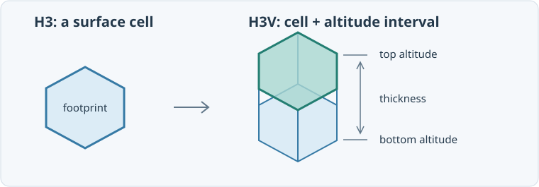

# H3V — Extending H3 into Three Dimensions

**Experimental preview 0.1.0.** Public API and serialized-index compatibility
are not yet guaranteed. Record the H3V package version alongside persisted
voxel IDs. The encoded format version is currently 4.

**H3V extends [H3](https://h3geo.org/) into a three-dimensional,
Earth-referenced spatial indexing system.** It combines H3's global grid with
an independent hierarchical radial grid, dividing space around and within
Earth into volumetric cells called **voxels**.

Each voxel preserves an original H3 cell index and adds a radial cell index.
The H3 cell defines its angular footprint; the radial cell defines its altitude
interval. Together they form a single 128-bit identifier. Existing H3-indexed
data can be associated with voxels through their unchanged H3 footprints.

H3V organizes locations through discrete region identifiers. Positions can be
assigned to voxels, grouped by identifier, and aggregated at coarser surface or
radial resolutions. This supports work with terrestrial, atmospheric, and orbital
data, including satellite communications, coverage analysis, and three-dimensional
geospatial analytics.



*Diagram only: actual voxel faces follow the spherical geometry of the grid.*

## Key capabilities

- **Three-dimensional indexing:** Convert latitude, longitude, and altitude
  into a 128-bit voxel ID.
- **Independent resolutions:** Choose H3 surface resolutions 0–15 and radial
  resolutions 0–10 separately.
- **Hierarchical organization:** Find parent and child voxels by changing
  surface resolution, radial resolution, or both.
- **Spatial traversal:** Calculate horizontal grid distances, rings, and disks
  within one radial cell, and encode directed connections between face-sharing voxels.
- **Geometric calculations:** Measure voxel volumes, straight-line distances,
  azimuth, elevation, off-axis angles, ECEF displacement vectors, great-circle
  arcs on midpoint spherical shells, and horizon-limited visibility caps.
- **H3 interoperability:** Extract a voxel's unchanged H3 cell index for use
  with H3-based data and tools.
- **Coordinate interfaces:** Convert spherical geographic coordinates or
  Earth-centered, Earth-fixed (ECEF) Cartesian coordinates to voxel IDs and back
  to representative centers.

Distances and altitudes default to kilometres, angles to degrees, and volumes
to cubic kilometres.

## Install

From a checkout of this repository, with Python 3.10 or later:

```console
python -m pip install .
```

The H3 dependency is installed automatically.

## First example

Find the voxel containing a point at latitude 52 degrees, longitude 13 degrees,
and altitude 1 km:

```{doctest}
>>> import h3v
>>> voxel = h3v.latlngalt_to_voxel(
...     52, 13, 1, surface_resolution=9, radial_resolution=7
... )
>>> h3v.get_resolution(voxel)
(9, 7)
>>> latitude, longitude, altitude_km = h3v.voxel_to_latlngalt(voxel)
>>> round(altitude_km, 4)
1.0018
```

A voxel ID represents a spatial region. Other points within the same voxel
receive the same ID. Decoding returns the H3 cell center at the radial midpoint,
so the decoded position can differ from the original input.

The resolutions control different aspects of that region:

- `surface_resolution` selects horizontal detail using standard H3 levels 0–15.
- `radial_resolution` selects altitude-interval thickness. Each additional
  level divides the thickness by seven, reaching approximately 2.26 cm at level 10.

For ECEF input, `ecef_to_voxel()` accepts X, Y, and Z in kilometres and defaults
to the finest supported resolutions: surface 15 and radial 10. Both can be overridden.

## The H3V grid

H3V combines two 64-bit indices into one 128-bit Python integer:

| Component | What it identifies |
|---|---|
| H3 cell index | The surface cell and its angular footprint |
| Radial cell index | A radial resolution and bin, defining an altitude interval |

The radial grid has 256 base cells, each one Earth radius thick. Each refinement
level divides a radial cell into seven children. It supports negative altitudes,
positions within Earth, and altitudes far beyond geostationary orbit, within
its finite [coordinate domain](format.md#base-intervals-and-altitude-limits).

The reference is H3's authalic Earth sphere, with a radius of about 6,371 km.
Altitude is measured relative to that sphere, rather than terrain or an
ellipsoid. Every valid voxel has positive volume, including voxels containing
altitude zero. Earth's center is excluded.

A radial cell has positive thickness. A **spherical shell**, as used by H3V's
geometry functions, is a fixed-radius surface with no thickness. A midpoint
shell passes through radial cell centers; visibility calculations can instead
use a target shell specified by altitude. See [radial terminology](concepts.md#radial-resolution-cells-intervals-and-spherical-shells)
for the full distinctions.

Voxel IDs serialize as 32-character lowercase hexadecimal strings. Extract
their H3 footprints when calling H3 functions; a complete H3V ID is a separate
format. H3V is an independent extension, not an official H3 format.

## Documentation

- [Understand the grid](concepts.md): voxels, radial cells, altitude intervals,
  spherical shells, and resolutions.
- [Usage guide](usage.md): common tasks with runnable examples.
- [API quick reference](api_quick.md): find functions by category.
- [API reference](api_reference.md): parameters, units, and return values.
- [Format specification](format.md): index encoding and exact interval rules.

## Project

H3V is under active development. The [repository](https://github.com/piglabsai/h3v)
contains the source and the [contributor guide](https://github.com/piglabsai/h3v/blob/main/docs/contributing.md)
for development setup, testing, and documentation builds. Licensed under the [Apache License 2.0](https://github.com/piglabsai/h3v/blob/main/LICENSE).

```{toctree}
:hidden:
:caption: Using H3V

concepts
usage
api_quick
api_reference
```

```{toctree}
:hidden:
:caption: Technical details

format
```
